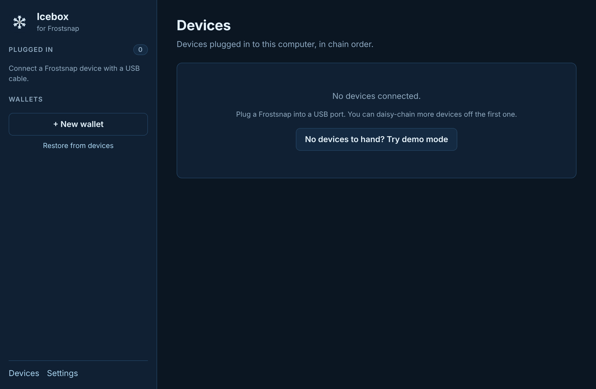
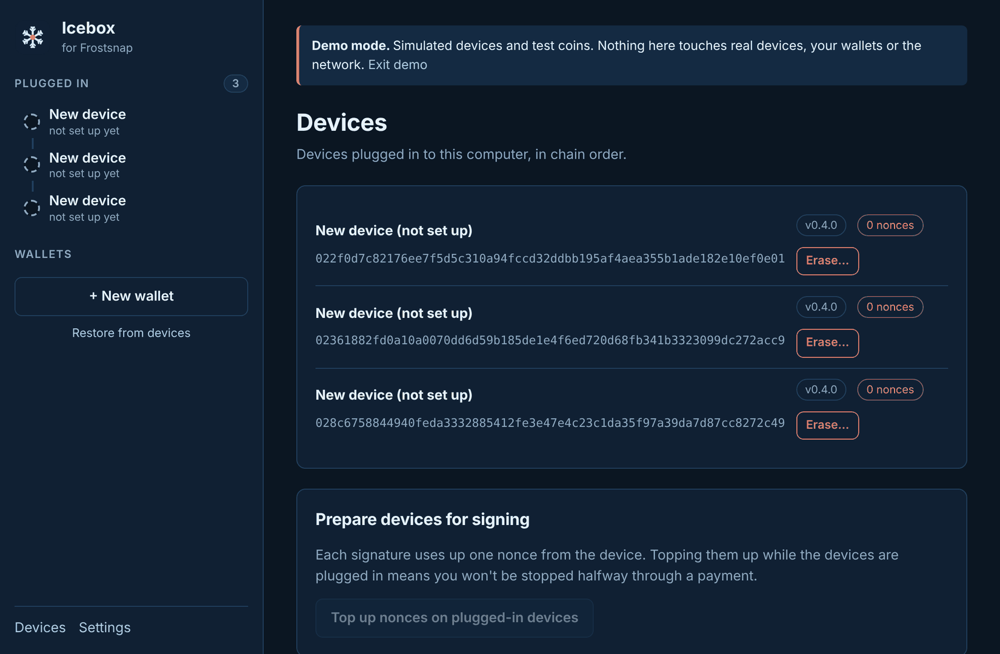

# 2. Try demo mode

[← Install](01-install.md) · [Contents](README.md) · Next: [Devices →](03-devices.md)

Demo mode lets you try every part of Icebox **without any Frostsnap devices**: creating a
wallet, backing it up, receiving, sending, restoring and erasing. It's ideal for a first look,
for workshops, and for showing someone how a multi-device wallet works.

## Start it

Either:

- choose **Help → Try demo mode** from the menu bar, or
- on an empty Devices page, click **No devices to hand? Try demo mode**.

Three pretend devices appear under **Plugged in**, and a yellow banner shows on every page so
you always know you're in the demo:

## What's safe about it

- **Nothing real is touched.** Real devices, your wallets, the database and the network are all
  left alone. Real devices plugged in while the demo runs are ignored.
- **Nothing is saved.** Everything lives in memory and disappears when you leave.
- **Demo addresses can't receive coins.** Their QR codes are deliberately unscannable and
  stamped **DEMO - NOT REAL**. Never send coins to an address shown in demo mode.
- **Demo transactions aren't on the real network**, so their links don't open mempool.space.

## A tour in ten minutes

1. **Create a wallet.** Click **+ New wallet**, name it, keep **Signet**, name the three devices,
   choose **2 of 3**, and click **Create keys**. See [Create a wallet](04-create-wallet.md).
2. **Back up.** Click **Show backup on device** for each one. In the demo it confirms itself
   after a moment.
3. **Look at History.** The demo wallet starts with some test coins, and a new incoming payment
   arrives a few seconds later.
4. **Receive.** Get an address and click **Check on a device**. See [Receive](05-receive.md).
5. **Send.** Paste any test address (for example
   `tb1qw508d6qejxtdg4y5r3zarvary0c5xw7kxpjzsx`), enter an amount, click **Suggest fee rates**,
   then **Review payment → Start signing → Ask to sign** twice, and **Broadcast payment**.
   See [Send](06-send.md).
6. **Check a backup** on the Backups tab. See [Backups](08-backups.md).
7. **Restore one device at a time.** Click **Restore from devices**, then **Demo: plug in a
   device holding an older wallet**. A device called Delta appears, holding one share of a wallet
   called "Old savings". Click **Save and continue later**, then click the demo button again:
   Delta is "left behind" and Echo is plugged in, as if you'd travelled to a second place. Click
   **Finish restoring Old savings**. See [Restore](07-restore.md#restoring-one-device-at-a-time).
8. **Erase.** On the Devices page, click **Erase…** next to a device to see the warnings.

Some things can't be done in demo mode, such as changing Electrum servers.

## Leave it

Click **Exit demo** in the yellow banner. Icebox restarts cleanly with your real devices and
wallets, exactly as they were.

[← Install](01-install.md) · [Contents](README.md) · Next: [Devices →](03-devices.md)
