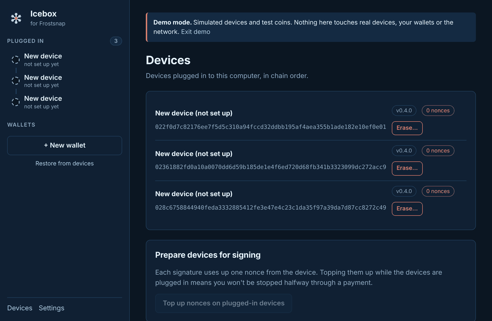
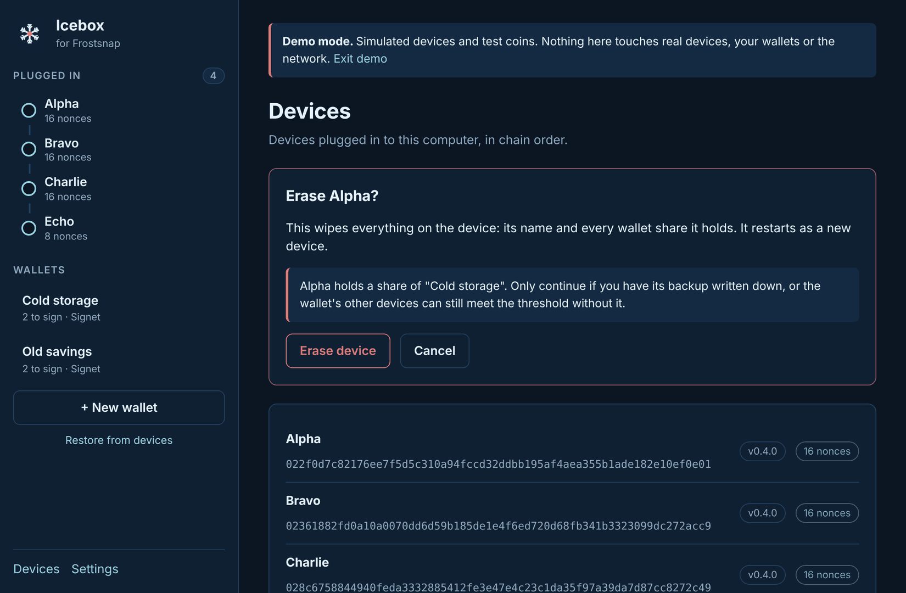

# 3. Devices

[← Demo mode](02-demo-mode.md) · [Contents](README.md) · Next: [Create a wallet →](04-create-wallet.md)

## Plugging in

Plug a Frostsnap into a USB port on your computer. You can **daisy-chain** more devices off the
first one, so a whole wallet can be plugged in through a single port.

Each device appears in the sidebar under **Plugged in**, in chain order:

- **New device / not set up yet**: a blank device, ready to join a new wallet.
- **A name and a nonce count** (e.g. "Alpha · 16 nonces"): a device that holds a wallet share.
- **connecting…**: the device is still starting up. If it doesn't clear within a few seconds,
  unplug it and plug it back in.

Open **View → Devices** (or click **Devices** at the bottom of the sidebar) for the full list.

For each device you'll see its name, its ID, its **firmware version**, its **nonce count**, and
an **Erase…** button.

## Firmware

Icebox is built against a particular Frostsnap version and expects matching device firmware
(shown on **Help → About Icebox**).

- **Firmware as expected:** a plain version pill, e.g. `v0.4.0`.
- **Older firmware:** a ⚠ pill and a warning. Update the device with the **official Frostsnap
  app**, then come back.
- **Firmware Icebox doesn't recognise:** newer than this Icebox build, or a development build.
  Check for a newer Icebox release.

Creating a wallet with a device that has a firmware warning needs you to tick **"I understand
the risk"**. Only do that on Signet.

Icebox can't update firmware yet. Use the official app for that (it's on the
[roadmap](../../ROADMAP.md)). Devices only accept firmware signed by Frostsnap.

## Nonces: preparing devices for signing

Every signature uses up one **nonce**, a single-use number stored on the device. When a
device runs low, it can't sign until it's topped up.

Icebox tops them up automatically when you create a wallet. You can also do it yourself: on the
Devices page, under **Prepare devices for signing**, click **Top up nonces on plugged-in
devices**. Doing this before an important payment means you won't be stopped halfway through.

Only devices that hold a wallet are topped up. Blank devices don't need nonces yet.

## Erasing a device

Erasing wipes **everything** on a device: its name and every wallet share it holds. It restarts
as a new, blank device.

1. On the Devices page, click **Erase…** next to the device.
2. Read the warning. If the device holds a share of a wallet, Icebox says which one.
3. Click **Erase device**.
4. **Confirm on the device itself.** Nothing is erased until you do.

> **Only erase a device that holds a wallet share if** you have that device's backup words
> written down, **or** the wallet's other devices can still meet the threshold without it.
> Otherwise you may lose access to the coins.

Erasing a brand-new blank device does no harm: it just restarts as blank.

**Removing a wallet from Icebox** is different from erasing: it only makes this computer forget
the wallet. See [Remove a wallet](09-details-and-export.md#remove-a-wallet-from-icebox).

[← Demo mode](02-demo-mode.md) · [Contents](README.md) · Next: [Create a wallet →](04-create-wallet.md)
