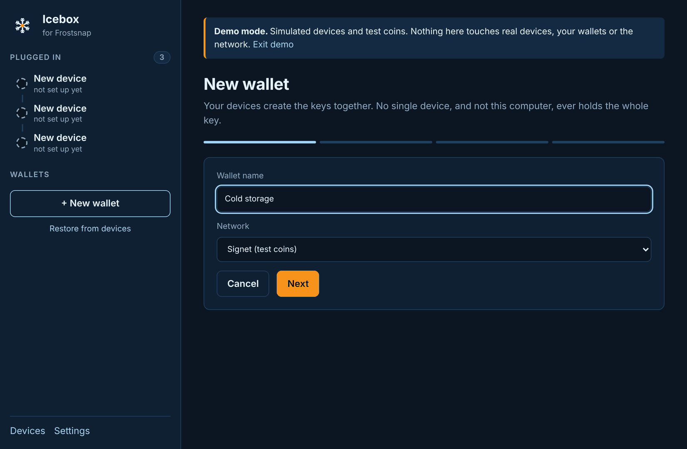
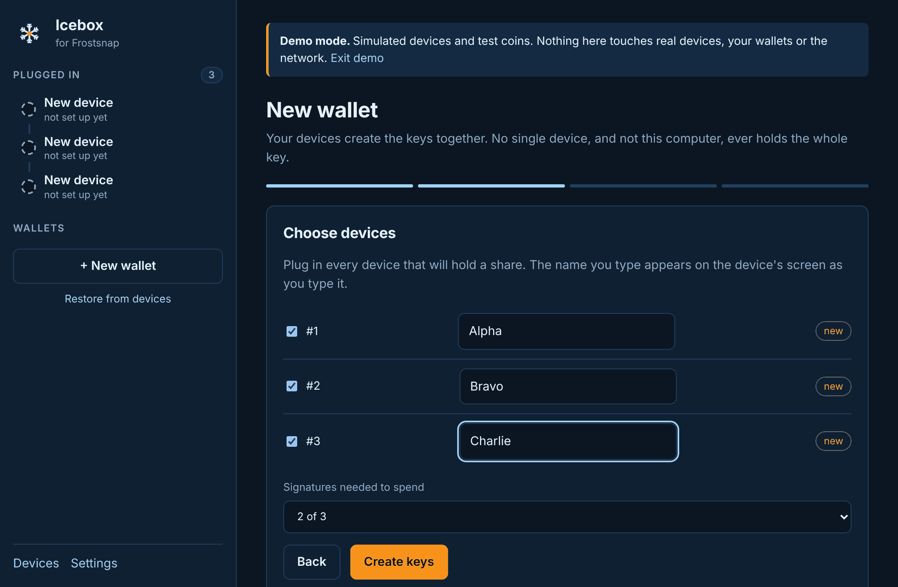
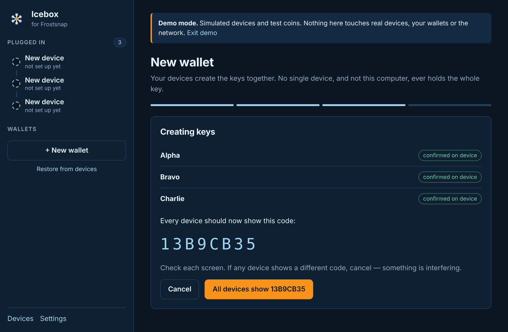
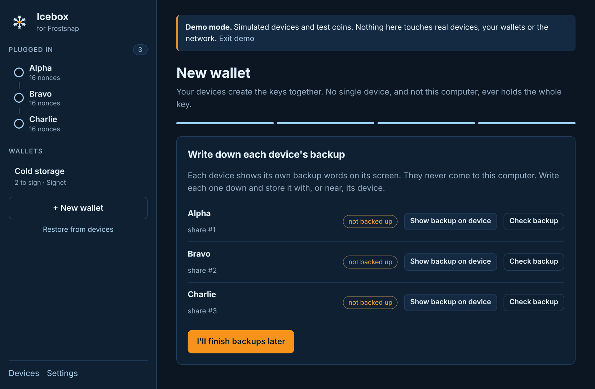
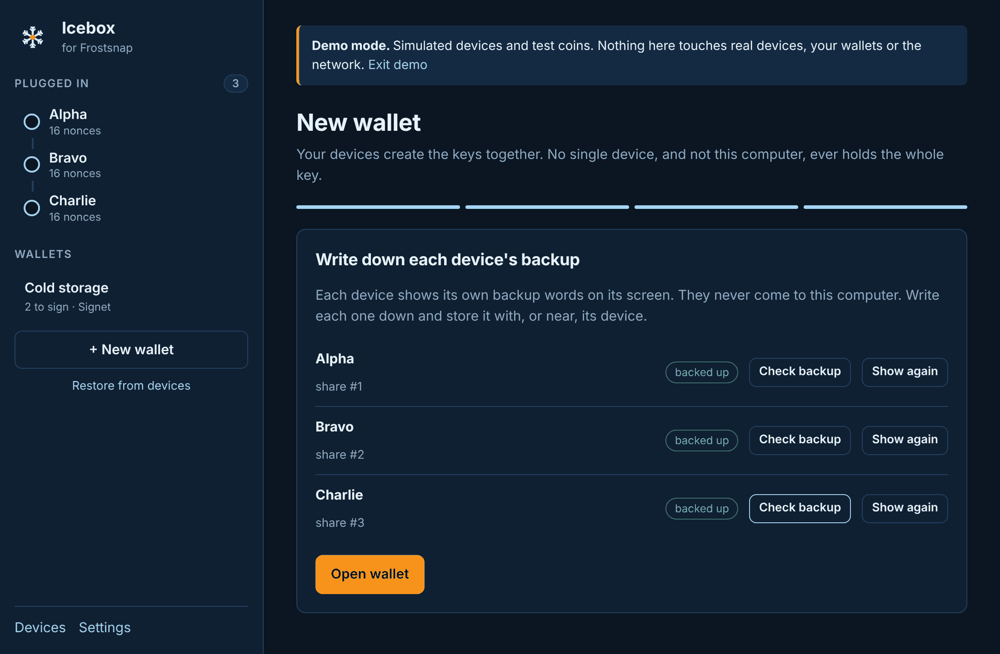
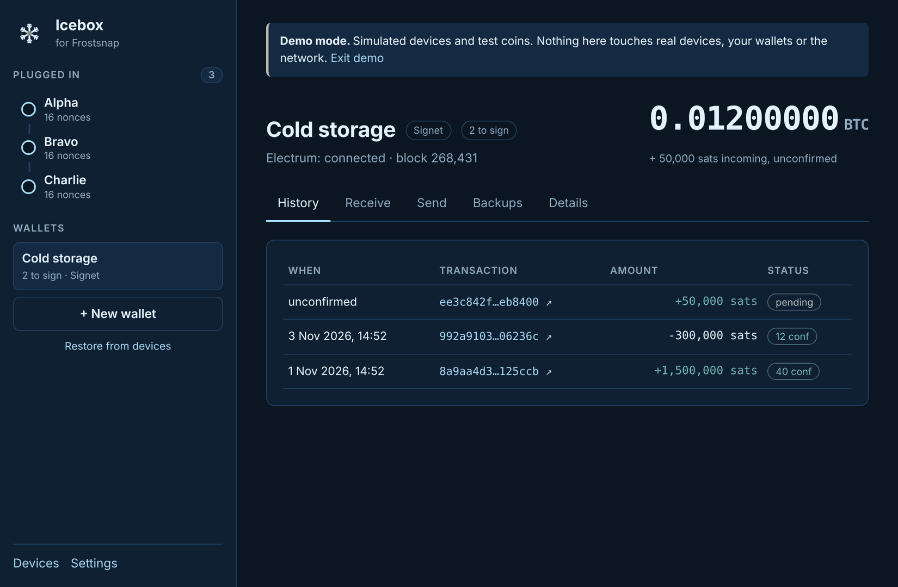

# 4. Create a wallet

[← Devices](03-devices.md) · [Contents](README.md) · Next: [Receive →](05-receive.md)

Your devices create the keys **together**. No single device, and not your computer, ever holds
the whole key. Spending later needs the number of devices you choose here.

**You need:** every device that will hold a share, plugged in, and all of them **blank**. As in
the official app, each device holds one wallet. A device that already has a name holds a wallet,
and must be unplugged (or [erased](03-devices.md#erasing-a-device)) first.

Click **+ New wallet** in the sidebar (or **Wallet → New wallet…**, or **Ctrl+N** / **⌘N**).

## Step 1: name and network

- **Wallet name:** up to 20 characters, e.g. "Cold storage". It's saved on each device.
- **Network:**
  - **Signet (test coins)**: start here. Coins are free from a Signet faucet and worthless.
  - **Testnet / Regtest (test coins)**: for developers.
  - **Mainnet (real bitcoin)**: real money. Icebox warns you to try Signet first and keep amounts
    small.

Click **Next**.

## Step 2: choose devices and the threshold

1. **Tick** each device that will hold a share.
2. **Name each device** (up to 14 characters). The name appears on the device's own screen as you
   type, which tells you which physical device is which. Neutral names like *Alpha*, *Bravo* and
   *Charlie* work well. Avoid names that say who holds a device or where it's kept: anyone who
   sees a device would learn that.
3. **Signatures needed to spend**: how many devices must approve each payment.

| Choice | What it means |
|--------|---------------|
| **2 of 3** | A good default. Any two devices can spend; you can lose one and still be fine. |
| **3 of 5** | More devices, more places. Lose up to two. |
| **1 of n** | Any single device can spend. Icebox warns you. |
| **n of n** | Every device is needed. Lose one and the coins are lost. Icebox warns you. |

Click **Create keys**. Icebox first tops up each device's nonces ("Preparing devices…"), then
starts key generation.

## Step 3: confirm the code on every device

Each device shows a **check code** and asks you to confirm. Icebox shows the same code in large
letters.

- **Look at every device.** All of them, and Icebox, must show the **same** code.
- Confirm on each device. Its line in Icebox turns to **confirmed on device**.
- If any device shows a **different** code, click **Cancel**: something is interfering.

When every device has confirmed, click **All devices show …**.

## Step 4: write down each device's backup

Each device has its **own backup words**, shown only on its own screen. They never come to the
computer.

For each device:

1. Click **Show backup on device**.
2. Write the words down, carefully and in order, on paper (or a metal backup).
3. Confirm on the device. Icebox marks it **backed up**.

Store each device's backup **with or near that device**, and the devices in **different places**.
Then losing one place loses at most one share.

Click **Open wallet**. If you need to stop, **I'll finish backups later** opens the wallet anyway;
a reminder stays at the top of the wallet until every device is backed up. You can do it any
time from the [Backups tab](08-backups.md).

## Your new wallet

The sidebar lists it as "2 to sign · Signet". The top shows the balance, the network, and the
connection to the Electrum server. The tabs are **History**, **Receive**, **Send**, **Backups**
and **Details**.

History lists each transaction with its date, amount and confirmations. Click a transaction ID to
open it on mempool.space in your browser.

[← Devices](03-devices.md) · [Contents](README.md) · Next: [Receive →](05-receive.md)
