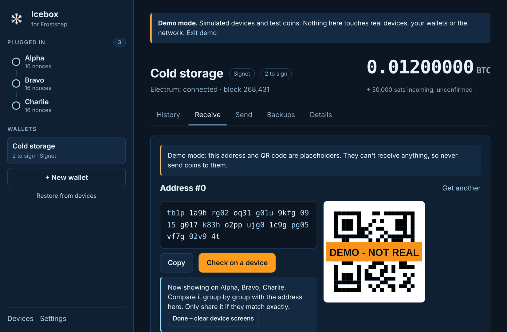
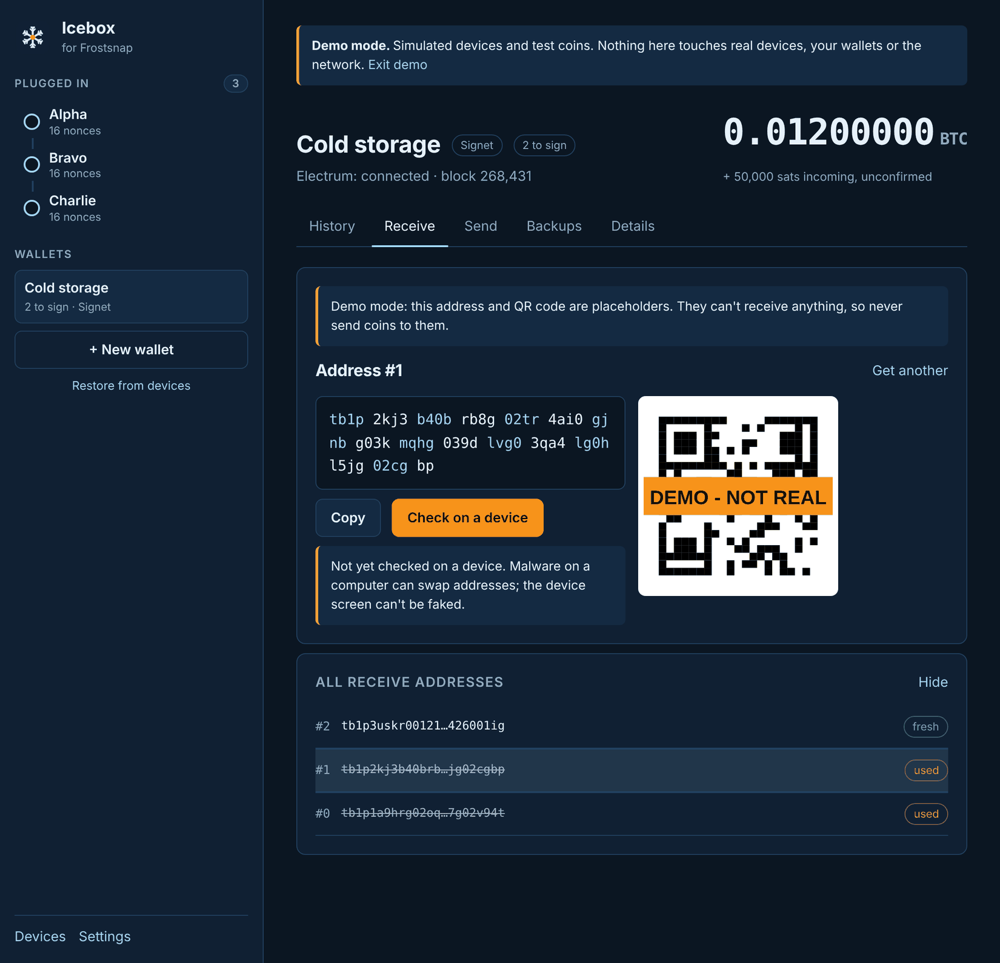

# 5. Receive bitcoin

[← Create a wallet](04-create-wallet.md) · [Contents](README.md) · Next: [Send →](06-send.md)

Open the wallet and click the **Receive** tab (or **Wallet → Receive**, **Ctrl+R** / **⌘R**).

## Get an address and check it on a device

1. Click **Get a receive address**. Icebox shows the address in groups of four characters, with
   a QR code.
2. Plug in **any one device** from this wallet and click **Check on a device**.
3. The device shows the same address. **Compare it group by group** with the one in Icebox.
4. Only share the address if they **match exactly**.
5. Click **Done – clear device screens** to send the devices back to their home screen.

**Why check?** Malware on a computer can quietly swap the address on screen for an attacker's.
It can't change what the device shows. Until you've checked, Icebox shows "Not yet checked on a
device".

To share the address, click **Copy** or let the payer scan the QR code. The QR code is a
`bitcoin:` link, so phone cameras offer to open a wallet app.

## Use a fresh address each time

Click **Get another** for a new address. Using a fresh address for every payment is better for
your privacy: reusing one links your payments together for anyone watching the blockchain.

Icebox remembers which addresses you've handed out (copied, checked on a device, or moved past
with Get another), so **Get another** always gives you one nobody has seen.

If an address you open has already received coins, Icebox warns you and offers **Use a fresh
address**.

## All receive addresses

Under the address, **All receive addresses → Show** lists every address so far, newest first:

| Mark | Meaning |
|------|---------|
| **fresh** | Not given to anyone yet. |
| **handed out** | Copied, checked on a device, or skipped with Get another. Nobody may have paid it yet. |
| **used** | Has received coins (shown crossed out). Don't give it out again. |

The list shows the start and end of each address to keep it compact; hover over one to see it
in full, or click it to show it again (full, with its QR code), for example to re-check it on a
device.

## When the coins arrive

An incoming payment shows straight away at the top of the wallet as
"+ … sats incoming, unconfirmed", and in **History** as **pending**. Once it's in a block it
shows **1 conf**, and the number rises with each new block.

If the incoming amount changes or a pending payment disappears before confirming, the sender
has probably replaced it (for example to raise its fee). That's normal on Bitcoin. Wait for it
to confirm.

[← Create a wallet](04-create-wallet.md) · [Contents](README.md) · Next: [Send →](06-send.md)
