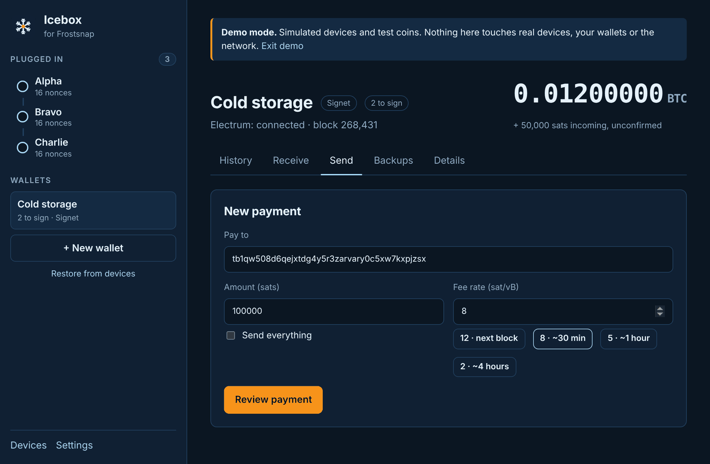
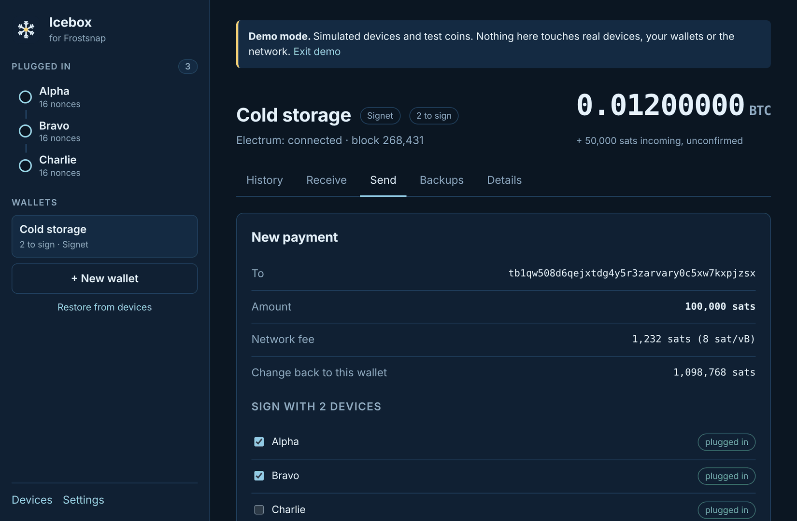
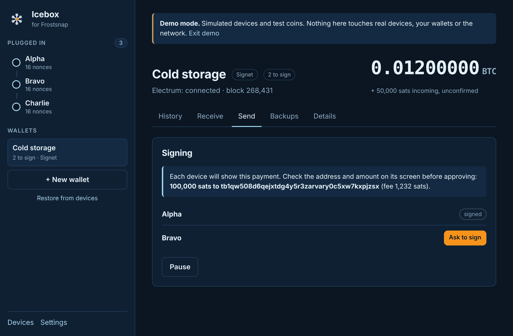
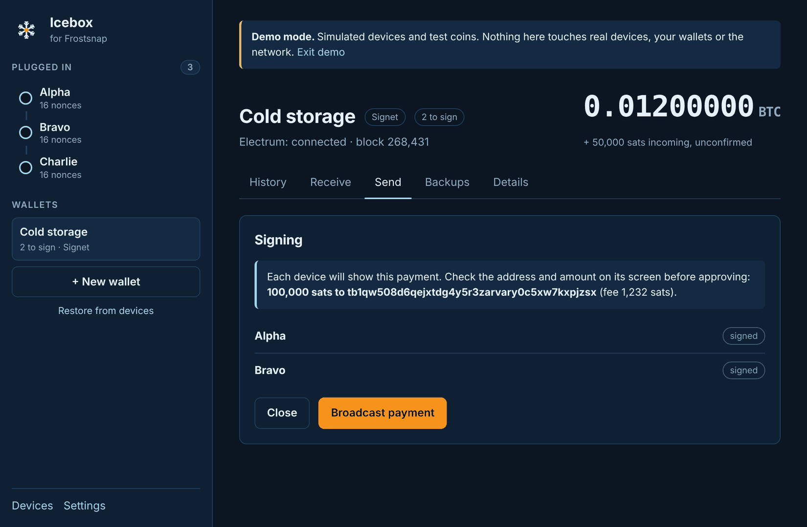
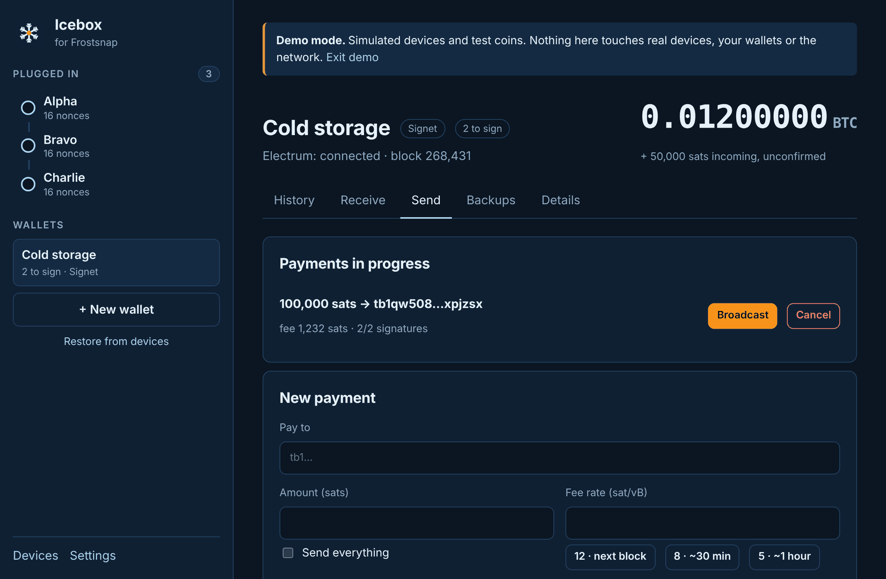

# 6. Send bitcoin

[← Receive](05-receive.md) · [Contents](README.md) · Next: [Restore a wallet →](07-restore.md)

Sending needs as many devices as the wallet's threshold, e.g. **2** for "2 to sign". You can
plug them in all together, or one after another.

Open the wallet and click the **Send** tab (or **Wallet → Send**, **Ctrl+S** / **⌘S**).

## 1. Enter the payment

- **Pay to:** the address, or a `bitcoin:` payment link (Icebox keeps just the address).
  Mainnet addresses start `bc1…`; Signet and Testnet ones start `tb1…`.
- **Amount (sats):** 1 bitcoin = 100,000,000 sats. Or tick **Send everything** to empty the
  wallet (the fee comes out of the amount).
- **Fee rate (sat/vB):** click **Suggest fee rates** for current estimates (next block, ~30 min,
  ~1 hour, ~4 hours) and pick one. Higher pays more and confirms sooner.

Click **Review payment**.

> Very small amounts (under about 330 sats, called "dust") can't be sent. Icebox stops you
> before signing.

## 2. Review and choose the signers

Check **To**, **Amount**, **Network fee**, and **Change back to this wallet**.

Under **Sign with 2 devices**, tick exactly as many devices as the threshold. Icebox pre-ticks
the ones already plugged in. Click **Edit** to change the payment, or **Start signing**.

## 3. Sign on each device

For each device:

1. Plug it in (if it isn't already) and click **Ask to sign**.
2. The device shows the payment. **Check the address and amount on the device's screen**, not
   just on the computer.
3. Approve on the device. Its line turns to **signed**.

If the device screen shows a different address or amount from what you meant to send,
**don't approve it**. Cancel the payment, and treat that computer as untrusted.

## 4. Broadcast

When every device has signed, click **Broadcast payment**. Icebox sends it to the network,
shows "Sent", and switches to **History**, where it appears as **pending** until it's mined.
Click the transaction ID to follow it on mempool.space.

## Pausing, continuing and cancelling

You don't have to finish in one go. Click **Pause** (or **Close** once it's signed) and the
payment waits under **Payments in progress**, even if you quit Icebox:

- **Continue signing:** pick up where you left off, e.g. when the next device is with you.
- **Broadcast:** for a payment that's already fully signed.
- **Cancel → Yes, cancel payment:** throws the payment away. Nothing was sent, and the coins stay
  in the wallet. You can cancel a fully signed payment too, as long as you haven't broadcast it.

## If broadcasting fails

Icebox explains the most common reasons:

| Message | What to do |
|---------|------------|
| An amount is too small ("dust") | Cancel it under Payments in progress and send a larger amount. |
| The fee rate is too low right now | Cancel it and send again with a higher fee rate. |
| Some of its coins were already spent | Another payment used the same coins. Cancel it and send again. |

Any other error is shown as "Broadcast failed: …". Check your connection in
[Settings](10-settings.md) and try again.

## Not yet in Icebox

Speeding up a stuck payment (RBF/CPFP), choosing which coins to spend, and PSBT import/export
are on the [roadmap](../../ROADMAP.md). For now, use the official Frostsnap app for those.

[← Receive](05-receive.md) · [Contents](README.md) · Next: [Restore a wallet →](07-restore.md)
