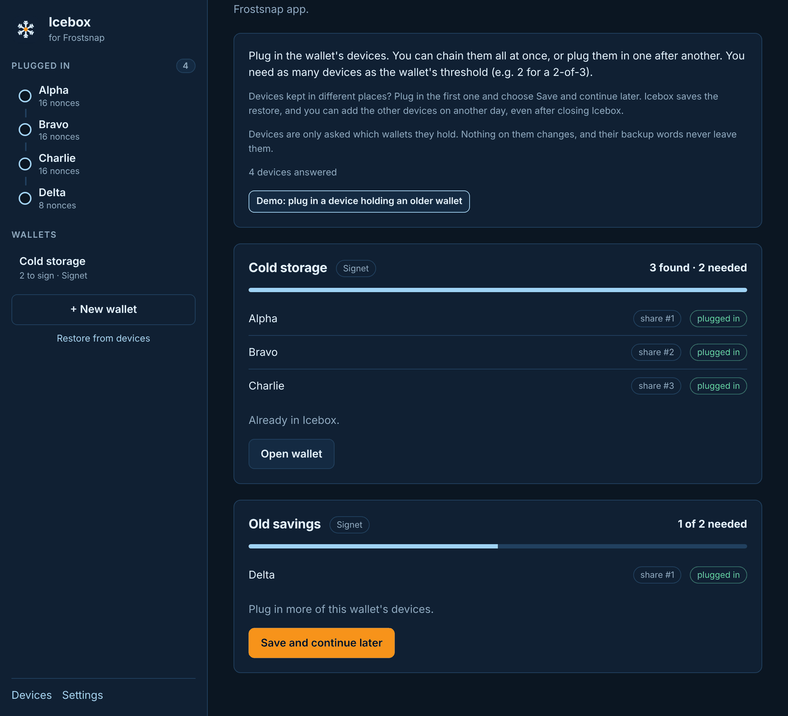
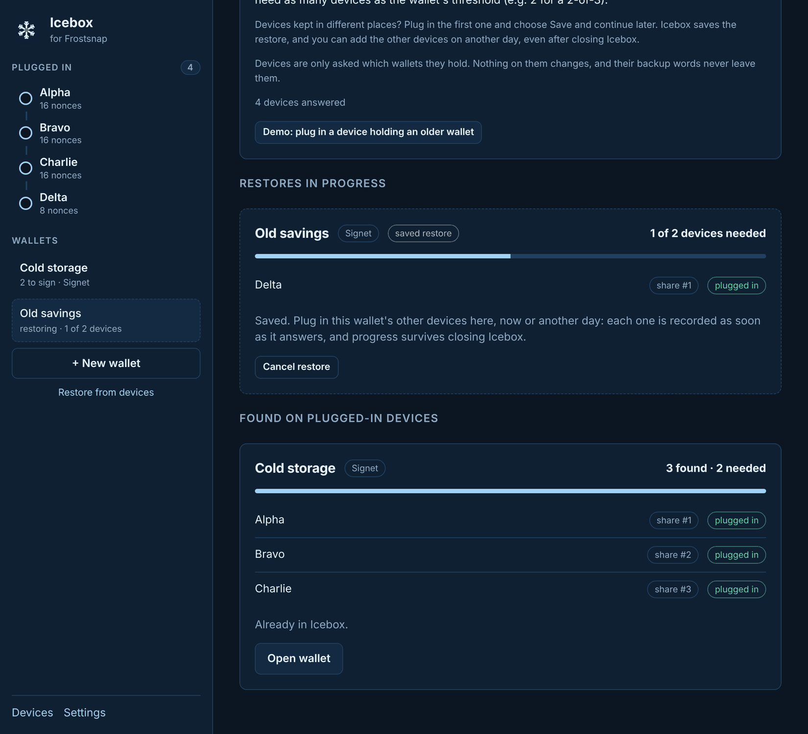
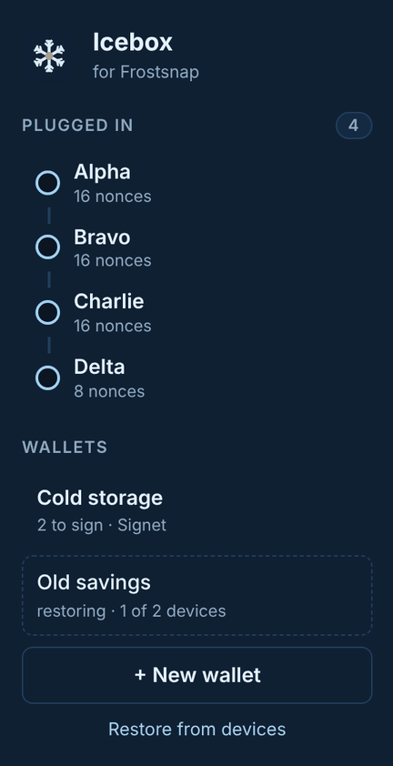
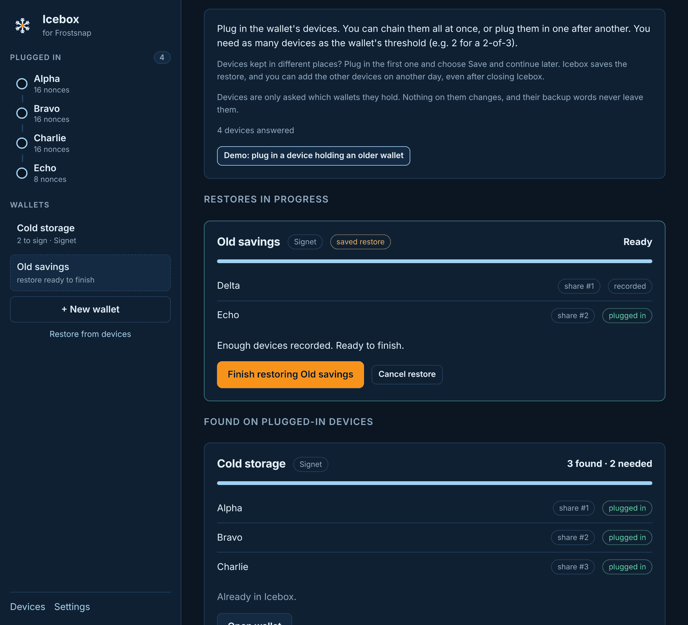
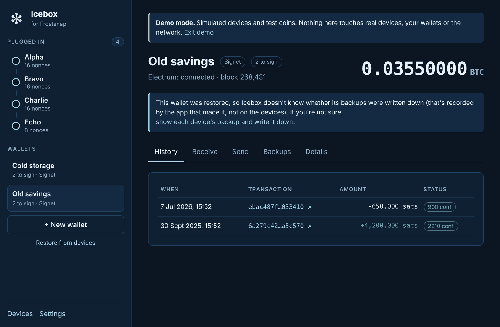

# 7. Restore a wallet

[← Send](06-send.md) · [Contents](README.md) · Next: [Backups →](08-backups.md)

**Restore from devices** rebuilds a wallet in Icebox from the devices that hold it. Use it:

- for a wallet you made in the **official Frostsnap app**,
- on a **new computer**, or after reinstalling,
- after **removing** a wallet from Icebox.

Restoring only **reads** the devices. Nothing on them changes, and their backup words never
leave them.

You need as many devices as the wallet's threshold: 2 for a 2-of-3 wallet. They **don't** have to
be in the same place at the same time; see
[Restoring one device at a time](#restoring-one-device-at-a-time).

## Restore with the devices together

1. Click **Restore from devices** in the sidebar (or **Wallet → Restore from devices…**).
2. Plug in the wallet's devices, chained together or one after another.
3. Icebox groups the devices by wallet and shows how many it has found against how many are
   needed, e.g. "2 found · 2 needed".
4. When it says **Enough devices found. Ready to restore.**, click **Restore *wallet name***.

Wallets already in Icebox show **Already in Icebox** with an **Open wallet** button.

If you restore a **mainnet** wallet, Icebox reminds you that it's new and unaudited: restoring is
safe, but be careful sending from it.

## Restoring one device at a time

Keeping a wallet's devices in **different places** is one of the main safety benefits of
Frostsnap. You can restore without bringing them together: take the computer to each device in
turn, and Icebox saves its progress in between, even if you close it or restart the computer.
This works the same way as in the official app. *(New in Icebox 0.3.)*

**At the first place:**

1. Open **Restore from devices** and plug in the first device.
2. The wallet appears with, for example, "1 of 2 needed". Click **Save and continue later**.

The restore now appears under **Restores in progress**, and in the sidebar under your wallets:

You can unplug the device, close Icebox and travel.

**At the next place:**

1. Open Icebox and click the restore in the sidebar (it shows "restoring · 1 of 2 devices"), or
   open **Restore from devices**.

   

2. Plug in the next device. Icebox recognises it and **records it straight away**: no button to
   press. Earlier devices show as **recorded**; the one in front of you shows **plugged in**.
3. Repeat at each place until it says **Enough devices recorded. Ready to finish.**
4. Click **Finish restoring *wallet name***.

Keep the **Restore from devices** page open while you plug each device in: that's when Icebox
asks devices what they hold.

**Cancelling:** click **Cancel restore**, then **Yes, cancel restore**. Icebox forgets the saved
restore; nothing on the devices changes, and you can start again any time.

**What's saved:** only public information, namely which wallet each device holds a share of, the
share's number, and its public "image" used to check the shares fit together. No backup words or
secret keys. It's stored in Icebox's [data folder](10-settings.md#data-folder) on this computer, so
continue on the **same computer**.

If a recorded device turns out not to belong to the wallet (for example a device from a different
wallet with the same name), it's marked **doesn't fit this wallet** and isn't used.

## After restoring

The wallet opens, syncs, and shows its balance and history.

**About the backup status:** whether a backup was written down is recorded by the app that made
the wallet, not on the devices. So a restored wallet shows each device as **unknown on this
computer**. If you're not sure the backups were written down, go to [Backups](08-backups.md) and
either **show** each device's backup and write it down, or **check** the backup you already have.

Restored wallets are labelled "2 to sign" rather than "2-of-3": Icebox only sees the devices you
plugged in, so it can't know how many exist in total.

**Spending also works one device at a time.** You never need the devices together again: start a
payment, sign with the device in front of you, then
[continue signing](06-send.md#pausing-continuing-and-cancelling) at the next place. Only creating
a new wallet needs every device together.

## Moving between Icebox and the official app

Icebox uses the official Frostsnap code for key generation and restoring, so wallets work in
both directions:

- a wallet made in the official app can be restored in Icebox, and
- a wallet made in Icebox can be restored in the official app.

Don't run both apps at the same time: only one can talk to the devices.

## Restoring from written-down backup words

Not in Icebox yet (it's on the [roadmap](../../ROADMAP.md)). If you've lost devices and need to
rebuild them from backup words, use the official Frostsnap app.

[← Send](06-send.md) · [Contents](README.md) · Next: [Backups →](08-backups.md)
