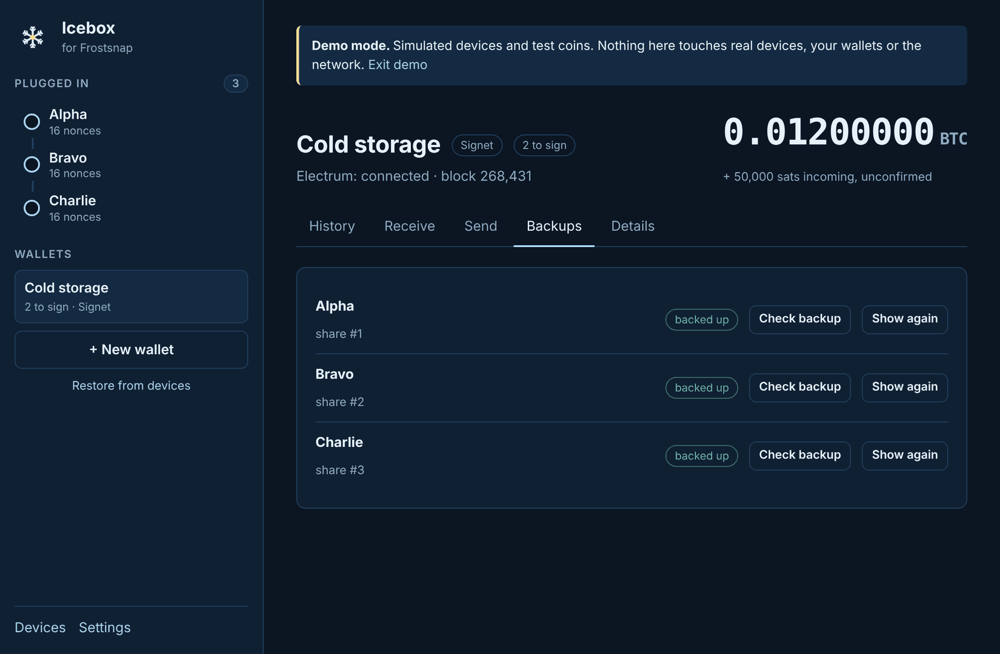
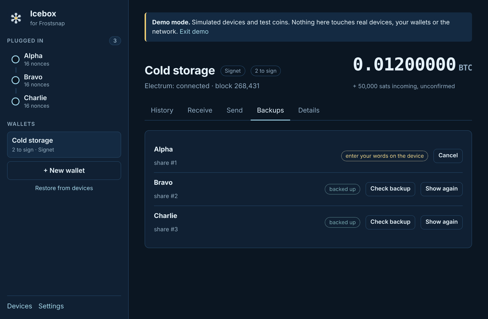

# 8. Backups

[← Restore](07-restore.md) · [Contents](README.md) · Next: [Wallet details and export →](09-details-and-export.md)

Every device has its **own** set of backup words: the backup of its share. With enough
backups (as many as the threshold), the wallet can be rebuilt even if the devices are lost.

The words are only ever shown **on the device's screen**. They never reach your computer, and
Icebox never asks you to type them.

## The Backups tab

Open the wallet and click **Backups**:

Each device has a status:

| Status | Meaning |
|--------|---------|
| **backed up** | You confirmed on the device that you'd written the words down (or checked them). |
| **not backed up** | Not done yet. A reminder shows at the top of the wallet until it is. |
| **unknown on this computer** | A [restored](07-restore.md) wallet: whoever made it may have backed it up, but Icebox can't tell. |

and some buttons (the device must be plugged in):

- **Show backup on device** / **Show again:** the device **displays** its words, so you can write
  them down (or write them down again). Confirm on the device when you're done.
- **Check backup:** **tests** the words you already wrote down, without displaying them (below).

The two can look alike on the device, since both go through the words one at a time, but
**Show** tells you the words and **Check** asks you for them.

## Check a backup

A backup you've never tested might have a mistake in it. **Check backup** lets you find out
safely:

1. Have your written-down words in front of you, plug in the device and click **Check backup**.
2. **Answer on the device.** For the share number and then each of the 25 words, the device
   offers **three choices**; tap the one on your paper. A wrong pick is shown in red. (Devices
   with firmware older than 0.3 ask you to type the words in instead.)
3. When every answer is right, the device shows a tick and Icebox shows "backup words match".

A backup that matches is marked **backed up**. If it doesn't match, use **Show again** and
write the words down afresh.

Click **Cancel**, or leave the tab, to stop a check. After a backup is shown or checked, Icebox
sends the device back to its home screen by itself after a moment.

We suggest checking each backup once after creating a wallet, and again every year or so.

## Storing backups

- Write each device's words on paper (or stamp them in metal), **in order**, and label which
  device and wallet they're for. A neutral label like "Cold storage: Alpha" is fine.
- Keep each backup **with or near its device**, and keep the devices in **different places**.
  Then losing one place loses at most one share, and a 2-of-3 wallet can still be spent.
- **Never** photograph the words, type them into a computer or phone, store them in a password
  manager or cloud, or give them to anyone who asks, whoever they say they are.

[← Restore](07-restore.md) · [Contents](README.md) · Next: [Wallet details and export →](09-details-and-export.md)
