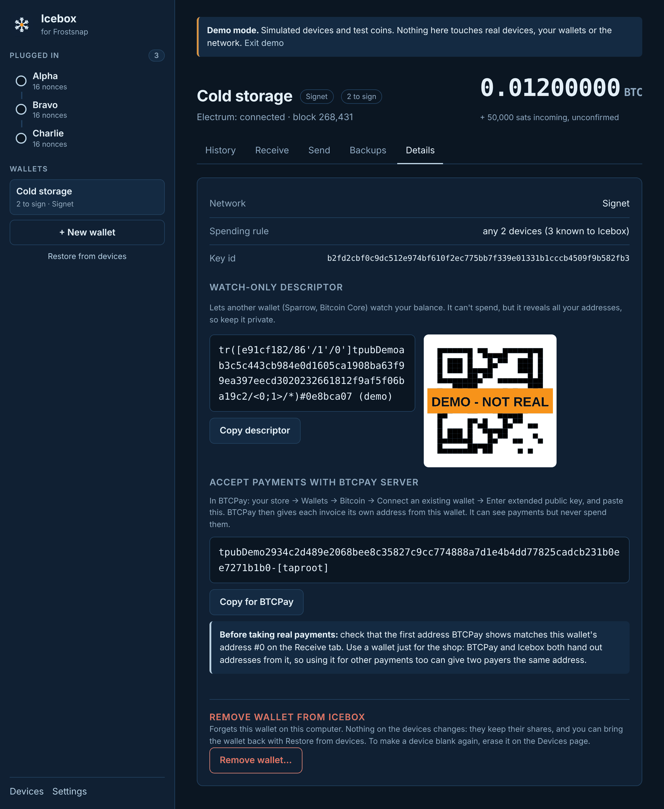
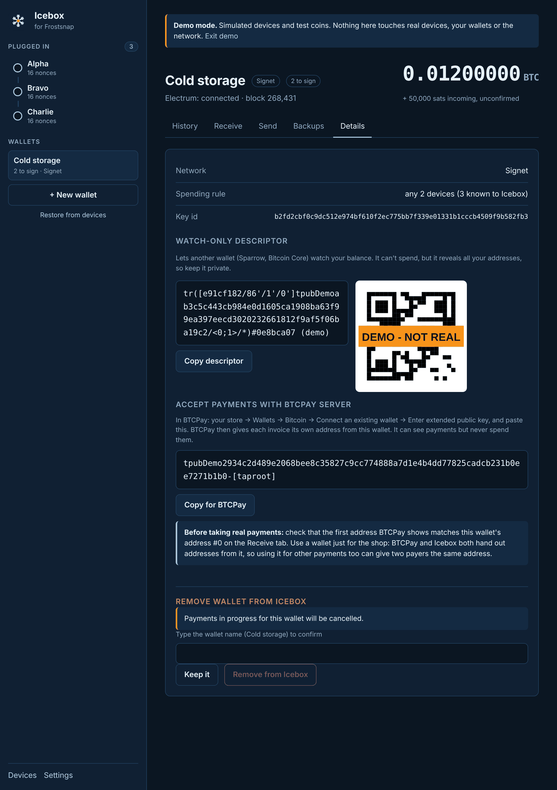

# 9. Wallet details and export

[← Backups](08-backups.md) · [Contents](README.md) · Next: [Settings and shortcuts →](10-settings.md)

Open the wallet and click **Details**.

At the top:

- **Network:** Mainnet, Signet, Testnet or Regtest.
- **Spending rule:** e.g. "any 2 devices (3 known to Icebox)".
- **Key id:** the wallet's identifier.

## Watch-only descriptor (Sparrow, Bitcoin Core and others)

The **descriptor** describes the wallet's public keys. Another wallet can import it to **watch**
your balance and history, and to generate the same receive addresses. It **can't spend**: that
still needs your devices.

- Click **Copy descriptor**, or scan the **QR code** with another device.
- **Sparrow:** File → New Wallet → give it a name → **Edit** (under Script Policy) → paste the
  descriptor, then Apply.
- **Bitcoin Core:** use `importdescriptors` in a new watch-only (`disable_private_keys`) wallet.

> **Keep the descriptor private.** It can't spend, but it reveals every address and payment in
> the wallet to whoever has it.

## Accept payments with BTCPay Server

If you run a shop on [BTCPay Server](https://btcpayserver.org), customers can pay **straight into
this multi-device wallet**. BTCPay only watches; spending still needs your devices, here in Icebox.

1. Click **Copy for BTCPay**. It's the wallet's extended public key in BTCPay's format, ending
   `-[taproot]`.
2. In BTCPay: **your store → Wallets → Bitcoin → Connect an existing wallet → Enter extended
   public key**, and paste it.
3. **Before taking real payments**, check that the first address BTCPay shows matches this
   wallet's **address #0** on the [Receive](05-receive.md) tab (open **All receive addresses** and
   click #0).

Two tips:

- **Use a separate wallet just for the shop.** BTCPay and Icebox both hand out addresses from the
  wallet without knowing about each other, so using it for other payments too can give two
  payers the same address.
- On mainnet, anyone with this key can see every payment to the wallet, so only paste it into a
  BTCPay server you run or trust.

## Remove a wallet from Icebox

**Remove wallet…** at the bottom of Details makes **this computer forget the wallet**. It's like
"Delete wallet" in the official app.

- **Nothing on the devices changes.** They keep their shares, and you can bring the wallet back
  any time with [Restore from devices](07-restore.md).
- Any payments in progress for the wallet are cancelled.
- To confirm, type the wallet's name and click **Remove from Icebox**. Or click **Keep it**.

On mainnet, before removing a wallet, make sure you can restore it: every device's backup is
written down, or enough of its devices are safe.

To make a **device** blank again (for example to reuse it in a new wallet), you need to
[erase it](03-devices.md#erasing-a-device) instead. Removing the wallet doesn't do that.

[← Backups](08-backups.md) · [Contents](README.md) · Next: [Settings and shortcuts →](10-settings.md)
