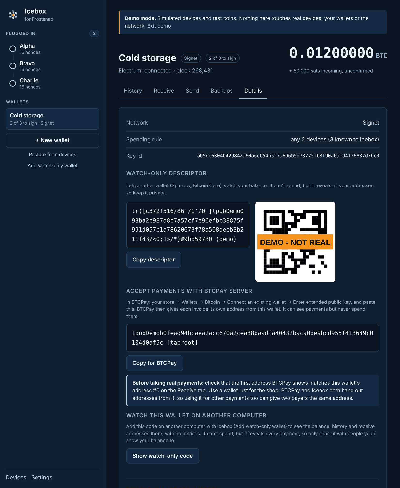
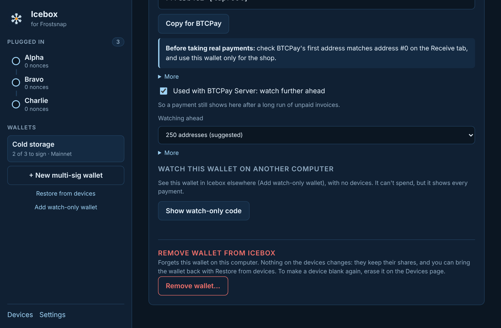
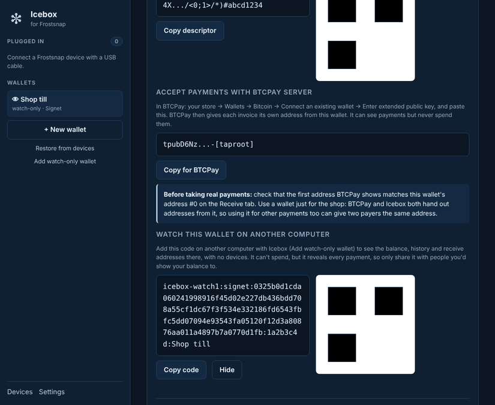
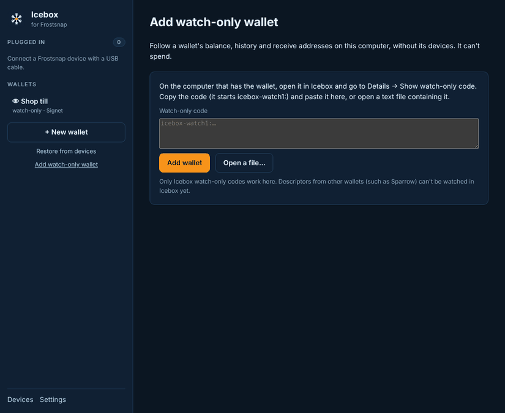
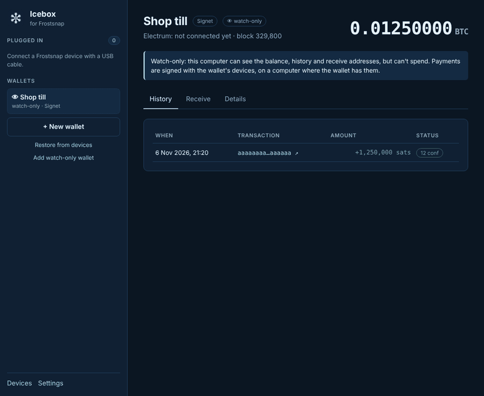
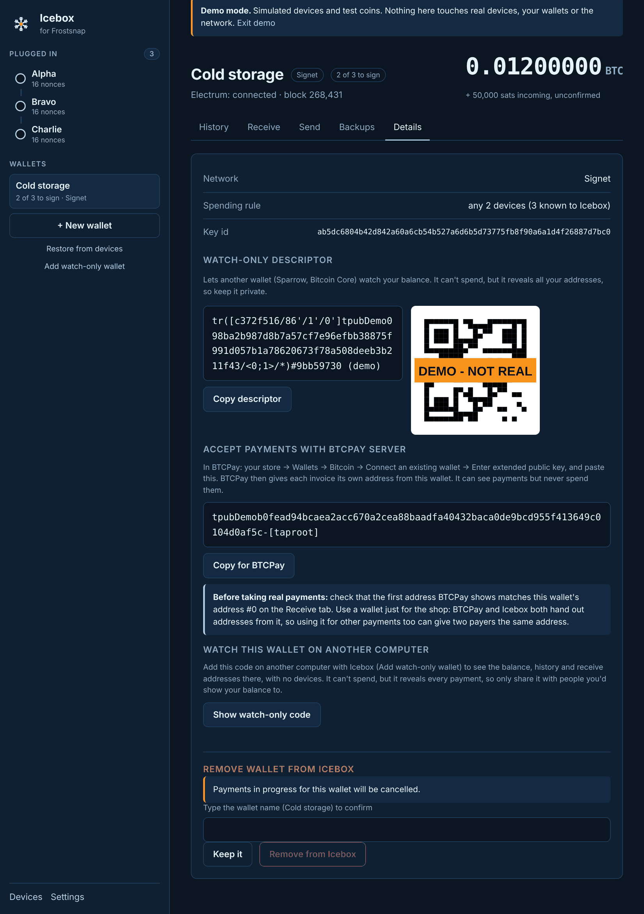

# 9. Wallet details and export

[← Backups](08-backups.md) · [Contents](README.md) · Next: [Settings and shortcuts →](10-settings.md)

Open the wallet and click **Details**.

At the top (below it, **Labels and exports**: see
[Labels, coins and exports](13-labels-coins-and-exports.md#exports)):

- **Network:** Mainnet, Signet, Testnet or Regtest.
- **Spending rule:** e.g. "any 2 devices (3 known to Icebox)".
- **Key id:** the wallet's identifier.

## Watch-only descriptor (Sparrow, Bitcoin Core and others)

The **descriptor** describes the wallet's public keys. Another wallet can import it to **watch**
your balance and history, and to generate the same receive addresses. It **can't spend**: that
still needs your devices.

- Click **Copy descriptor**, or scan the **QR code** with another device.
- **Sparrow:** File → New Wallet → give it a name → **Edit** (under Script Policy) → paste the
  descriptor, then Apply.
- **Bitcoin Core:** use `importdescriptors` in a new watch-only (`disable_private_keys`) wallet.

> **Keep the descriptor private.** It can't spend, but it reveals every address and payment in
> the wallet to whoever has it.

## Accept payments with BTCPay Server

If you run a shop on [BTCPay Server](https://btcpayserver.org), customers can pay **straight into
this multi-device wallet**. BTCPay only watches; spending still needs your devices, here in Icebox.

1. Click **Copy for BTCPay**. It's the wallet's extended public key in BTCPay's format, ending
   `-[taproot]`.
2. In BTCPay: **your store → Wallets → Bitcoin → Connect an existing wallet → Enter extended
   public key**, and paste it.
3. **Before taking real payments**, check that the first address BTCPay shows matches this
   wallet's **address #0** on the [Receive](05-receive.md) tab (open **All receive addresses** and
   click #0).

Two tips:

- **Use a separate wallet just for the shop.** BTCPay and Icebox both hand out addresses from the
  wallet without knowing about each other, so using it for other payments too can give two
  payers the same address.
- On mainnet, anyone with this key can see every payment to the wallet, so only paste it into a
  BTCPay server you run or trust.

### Watch further ahead for BTCPay *(new in 0.5)*

BTCPay gives every invoice its own address, and invoices nobody pays leave addresses unused.
Icebox normally asks its Electrum server about addresses up to 50 past the last one it has handed
out, so after more than 50 unpaid invoices in a row, a payment to a later invoice wouldn't show in
Icebox (BTCPay would still see it).

Tick **Used with BTCPay Server: watch further ahead** below the key, choose how far (100, 250, 500
or 1000 addresses; 250 suits most shops) and click **Start watching**. Icebox then watches that
many addresses past the last one that received coins, and keeps moving the window forward as
payments arrive. It also counts those addresses as handed out, so addresses from Icebox's own
Receive tab start after them and never clash with BTCPay's.

This can only be widened, not narrowed or undone: addresses already counted as handed out stay
that way, and unticking the box only stops Icebox watching further ahead.

The trade-off is privacy: your Electrum server is told about more of your addresses. Point mainnet
at [your own node](10-settings.md#use-your-own-node-recommended-for-mainnet) for the most privacy.
A newly watched address is picked up at the next block.

## Watch this wallet on another computer

A **watch-only wallet** shows a wallet's balance, history and receive addresses on a computer that
has none of its devices: for a treasurer, a shop's till, or your own second laptop. It can't spend.
*(New in Icebox 0.4.)*

**On the computer that has the wallet:** open it, go to **Details → Show watch-only code**, and
copy the code (it starts `icebox-watch1:`) or let the other computer scan the QR code.

**On the other computer:** click **Add watch-only wallet** in the sidebar, then paste the code,
**Scan QR code** with the webcam, or **Open a file…** containing it. Click **Add wallet**.

The wallet appears in the sidebar with an 👁 and "watch-only". It has **History**, **Receive** and
**Details** tabs, but no Send or Backups:

Good to know:

- **Receive addresses can't be checked on a device** from a watch-only computer, because it has
  no devices. Before giving out an address for a large payment, check it on one of the wallet's
  devices from the computer that has them; it's the same address there.
- **Keep the code private.** Like the descriptor, it can't spend, but it reveals every address and
  payment of the wallet.
- **Only Icebox codes work.** Icebox can't watch a wallet from another app's descriptor (such as
  Sparrow's) yet, because Frostsnap's wallet engine needs a key the descriptor doesn't contain.
- If you later [restore the wallet from its devices](07-restore.md) on the same computer, the
  full wallet replaces the watch-only one in the sidebar.
- **Stop watching** (Details, at the bottom) forgets the watch-only wallet on that computer.
  Nothing else changes.

## Remove a wallet from Icebox

**Remove wallet…** at the bottom of Details makes **this computer forget the wallet**. It's like
"Delete wallet" in the official app.

- **Nothing on the devices changes.** They keep their shares, and you can bring the wallet back
  any time with [Restore from devices](07-restore.md).
- Any payments in progress for the wallet are cancelled.
- To confirm, type the wallet's name and click **Remove from Icebox**. Or click **Keep it**.

On mainnet, before removing a wallet, make sure you can restore it: every device's backup is
written down, or enough of its devices are safe.

To make a **device** blank again (for example to reuse it in a new wallet), you need to
[erase it](03-devices.md#erasing-a-device) instead. Removing the wallet doesn't do that.

[← Backups](08-backups.md) · [Contents](README.md) · Next: [Settings and shortcuts →](10-settings.md)
