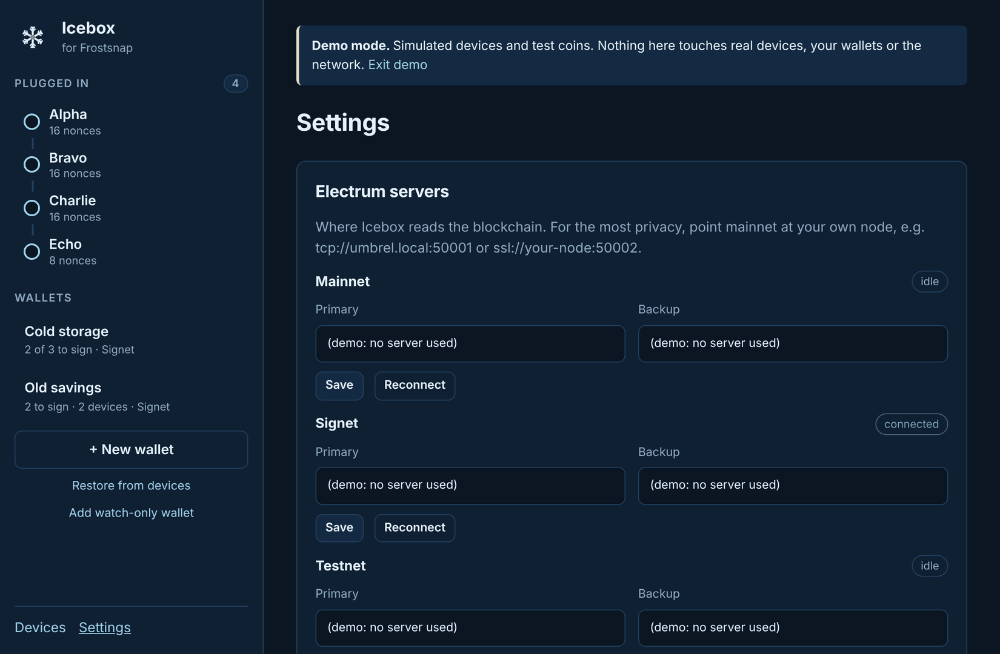
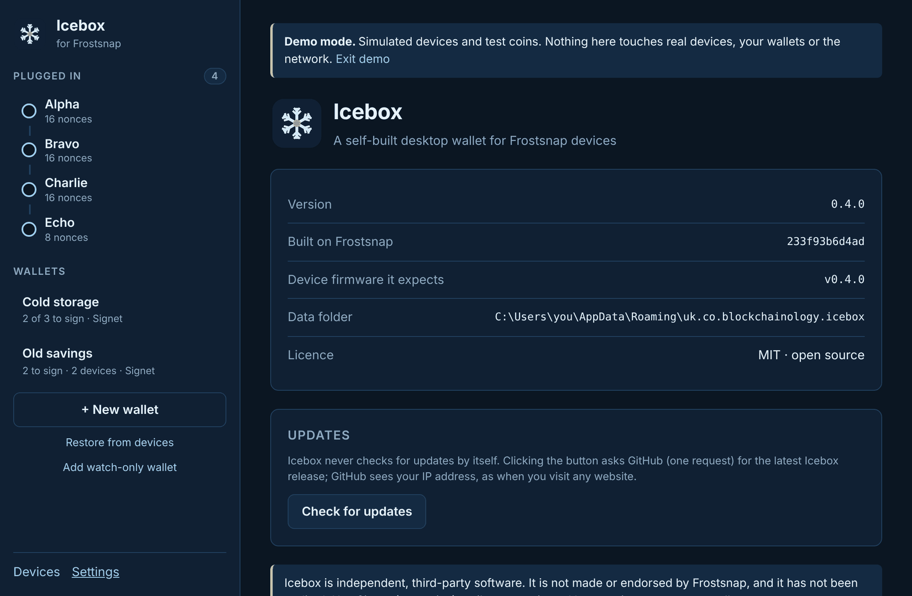

# 10. Settings and shortcuts

[← Wallet details](09-details-and-export.md) · [Contents](README.md) · Next: [Updating →](11-updating.md)

Open **File → Settings** (**Ctrl+,** / **⌘,**) or click **Settings** at the bottom of the
sidebar.

## Electrum servers

Icebox reads the blockchain (balances, history, fee estimates) and broadcasts payments through
an **Electrum server**. Each network has a **Primary** server and a **Backup** that's used if the
primary is down. The pill next to each network shows its connection: **connected**,
**connecting**, **disconnected** or **idle** (not in use).

The defaults are public servers, the same ones the official Frostsnap app uses. They work, but a
public server can see which addresses you ask about.

### Use your own node (recommended for mainnet)

If you run a Bitcoin node with an Electrum server (Umbrel, Start9, RaspiBlitz, myNode, a Fulcrum or
electrs install), point Icebox at it:

1. In the **Mainnet** row, enter your server as the **Primary**, e.g.
   - `tcp://umbrel.local:50001` for a node on your home network, or
   - `ssl://your-node.example:50002` for a node with a proper TLS certificate.
2. Click **Save**, then **Reconnect**. The pill should turn to **connected**.

Server addresses always start with `ssl://` or `tcp://`, then `host:port`.

> `tcp://` is unencrypted, so use it only for a node on your own network. Icebox can't yet accept
> a **self-signed** certificate (it's on the [roadmap](../../ROADMAP.md)), so use `tcp://` on your
> own network, or a server with a proper certificate.

### Going back to the defaults

Each network has a **Restore defaults** button, which puts its Primary and Backup back to the
default servers (hover over it to see which). **Restore all defaults**, further down, does every
network at once and also turns **Hide amounts** off. Neither touches your wallets, devices or saved
restores.

| Network | Default primary | Default backup |
|---------|-----------------|----------------|
| Mainnet | `ssl://blockstream.info:700` | `ssl://electrum.acinq.co:50002` |
| Signet | `tcp://signet.musdomworks.com:50001` | `ssl://mempool.space:60602` |
| Testnet | `tcp://electrum.blockstream.info:60001` | `ssl://blockstream.info:993` |
| Regtest | `tcp://localhost:60401` | `tcp://127.0.0.1:51001` |

## Privacy: hide amounts

Tick **Hide amounts** (or press **Ctrl+B** / **⌘B**, or click the eye next to a wallet's balance)
to show the balance, incoming amounts and payment history as `•••••`. Handy when someone can see
your screen, or when sharing it on a call. Icebox remembers the choice until you turn it off.

Amounts on the **Send** page stay visible: you need to see what you're about to approve.

## Logs

Icebox keeps a log of what it does: devices plugging in, server connections, errors. If something
goes wrong, the log helps work out why. Open it from **Settings → View logs** or **Help → Logs**:

- **Copy** puts the log on the clipboard, to paste into an email.
- **Show log file** opens the folder holding it (`logs/icebox.log` in the data folder), so you can
  attach the file instead.

The log never contains backup words or keys, and doesn't list addresses or amounts. It can contain
device and wallet ids, server names and the ids of payments you've sent, and your home folder is
shown as `~`. Read it before sharing, and send it privately rather than posting it in a public issue.

## Data folder

The **Data** section shows where Icebox keeps its wallet database. It holds **no private keys**
(those stay on the devices), but it does reveal your addresses, balances and history, so treat
it as private. Full-disk encryption (BitLocker, FileVault, LUKS) protects it.

| System | Default folder |
|--------|----------------|
| Windows | `%APPDATA%\uk.co.blockchainology.icebox` |
| macOS | `~/Library/Application Support/uk.co.blockchainology.icebox` |
| Linux | `~/.local/share/uk.co.blockchainology.icebox` |

To use a different folder, set the `ICEBOX_DATA_DIR` environment variable before starting Icebox.

## About Icebox

**Help → About Icebox** shows the version, the Frostsnap code it's built on, the device firmware
it expects, and the data folder. Include these when you [report a problem](https://github.com/amisatoshi/icebox/issues).
It also has a **Check for updates** button; see [Updating](11-updating.md#finding-out-about-new-versions).

## Menus and keyboard shortcuts

Use **Ctrl** on Windows and Linux, **⌘** on macOS.

| Menu | Item | Shortcut |
|------|------|----------|
| File | Settings | Ctrl/⌘ + , |
| File | Quit Icebox | Ctrl/⌘ + Q |
| Wallet | New multi-sig wallet… | Ctrl/⌘ + N |
| Wallet | Restore from devices… | |
| Wallet | Add watch-only wallet… | |
| Wallet | Receive | Ctrl/⌘ + R |
| Wallet | Send | Ctrl/⌘ + S |
| View | Devices | Ctrl/⌘ + D |
| View | Hide or show balances | Ctrl/⌘ + B |
| Help | User guide (opens this guide in your browser) | |
| Help | Keyboard shortcuts | Ctrl/⌘ + / |
| Help | Try demo mode | |
| Help | Check for updates | |
| Help | Logs | |
| Help | Report a bug (opens the bug report form on GitHub) | |
| Help | About Icebox | |

Receive and Send open the wallet you're looking at (or your first wallet).

Icebox remembers its window size and position between runs.

[← Wallet details](09-details-and-export.md) · [Contents](README.md) · Next: [Updating →](11-updating.md)
