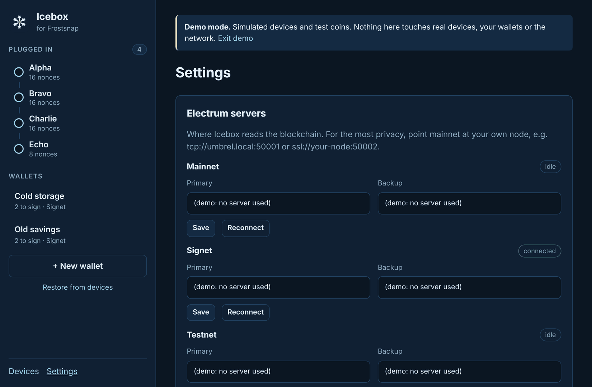
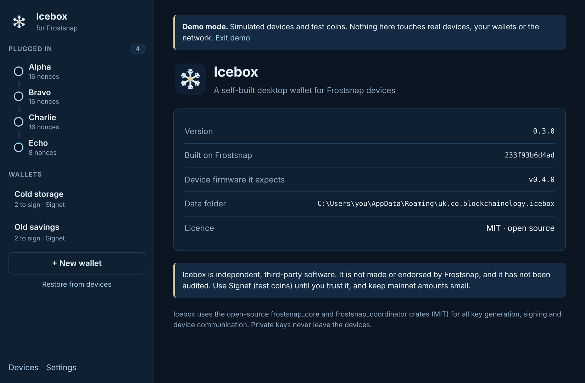

# 10. Settings and shortcuts

[← Wallet details](09-details-and-export.md) · [Contents](README.md) · Next: [Updating →](11-updating.md)

Open **File → Settings** (**Ctrl+,** / **⌘,**) or click **Settings** at the bottom of the
sidebar.

## Electrum servers

Icebox reads the blockchain (balances, history, fee estimates) and broadcasts payments through
an **Electrum server**. Each network has a **Primary** server and a **Backup** that's used if the
primary is down. The pill next to each network shows its connection: **connected**,
**connecting**, **disconnected** or **idle** (not in use).

The defaults are public servers, the same ones the official Frostsnap app uses. They work, but a
public server can see which addresses you ask about.

### Use your own node (recommended for mainnet)

If you run a Bitcoin node with an Electrum server (Umbrel, Start9, RaspiBlitz, myNode, a Fulcrum or
electrs install), point Icebox at it:

1. In the **Mainnet** row, enter your server as the **Primary**, e.g.
   - `tcp://umbrel.local:50001` for a node on your home network, or
   - `ssl://your-node.example:50002` for a node with a proper TLS certificate.
2. Click **Save**, then **Reconnect**. The pill should turn to **connected**.

Server addresses always start with `ssl://` or `tcp://`, then `host:port`.

> `tcp://` is unencrypted, so use it only for a node on your own network. Icebox can't yet accept
> a **self-signed** certificate (it's on the [roadmap](../../ROADMAP.md)), so use `tcp://` on your
> own network, or a server with a proper certificate.

## Data folder

The **Data** section shows where Icebox keeps its wallet database. It holds **no private keys**
(those stay on the devices), but it does reveal your addresses, balances and history, so treat
it as private. Full-disk encryption (BitLocker, FileVault, LUKS) protects it.

| System | Default folder |
|--------|----------------|
| Windows | `%APPDATA%\uk.co.blockchainology.icebox` |
| macOS | `~/Library/Application Support/uk.co.blockchainology.icebox` |
| Linux | `~/.local/share/uk.co.blockchainology.icebox` |

To use a different folder, set the `ICEBOX_DATA_DIR` environment variable before starting Icebox.

## About Icebox

**Help → About Icebox** shows the version, the Frostsnap code it's built on, the device firmware
it expects, and the data folder. Include these when you [report a problem](https://github.com/amisatoshi/icebox/issues).

## Menus and keyboard shortcuts

Use **Ctrl** on Windows and Linux, **⌘** on macOS.

| Menu | Item | Shortcut |
|------|------|----------|
| File | Settings | Ctrl/⌘ + , |
| File | Quit Icebox | Ctrl/⌘ + Q |
| Wallet | New wallet… | Ctrl/⌘ + N |
| Wallet | Restore from devices… | |
| Wallet | Receive | Ctrl/⌘ + R |
| Wallet | Send | Ctrl/⌘ + S |
| View | Devices | Ctrl/⌘ + D |
| Help | Try demo mode | |
| Help | About Icebox | |

Receive and Send open the wallet you're looking at (or your first wallet).

Icebox remembers its window size and position between runs.

[← Wallet details](09-details-and-export.md) · [Contents](README.md) · Next: [Updating →](11-updating.md)
