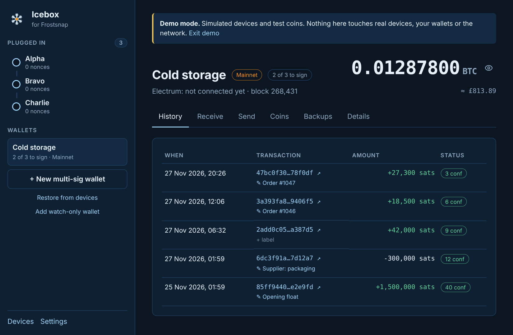
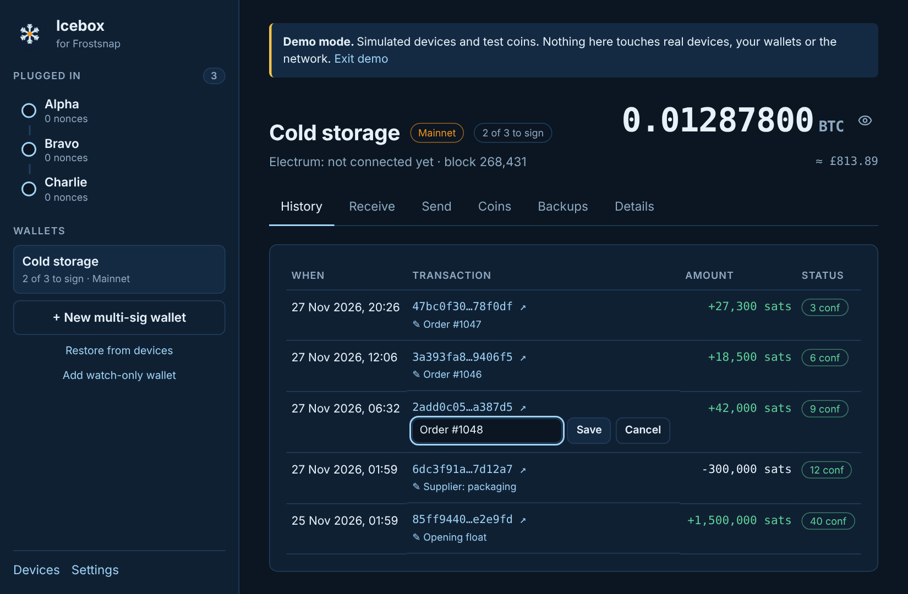
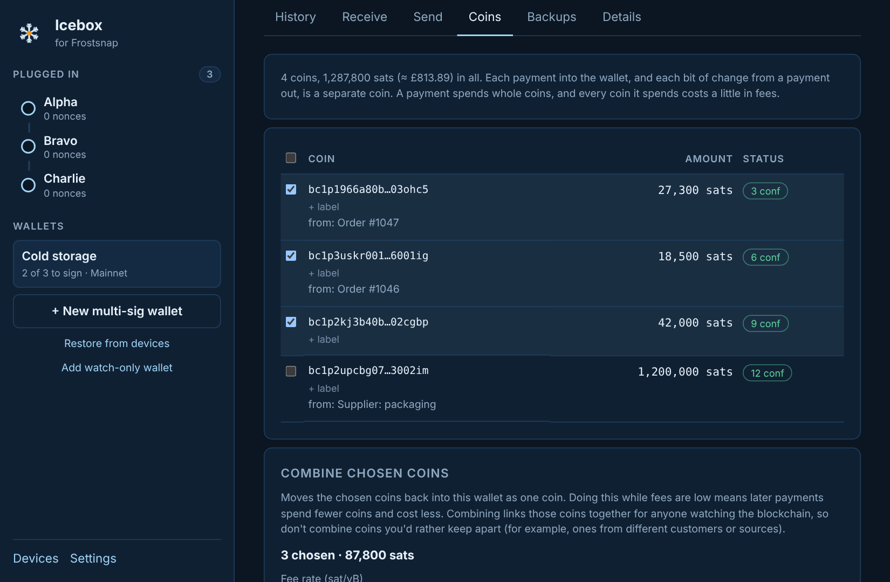
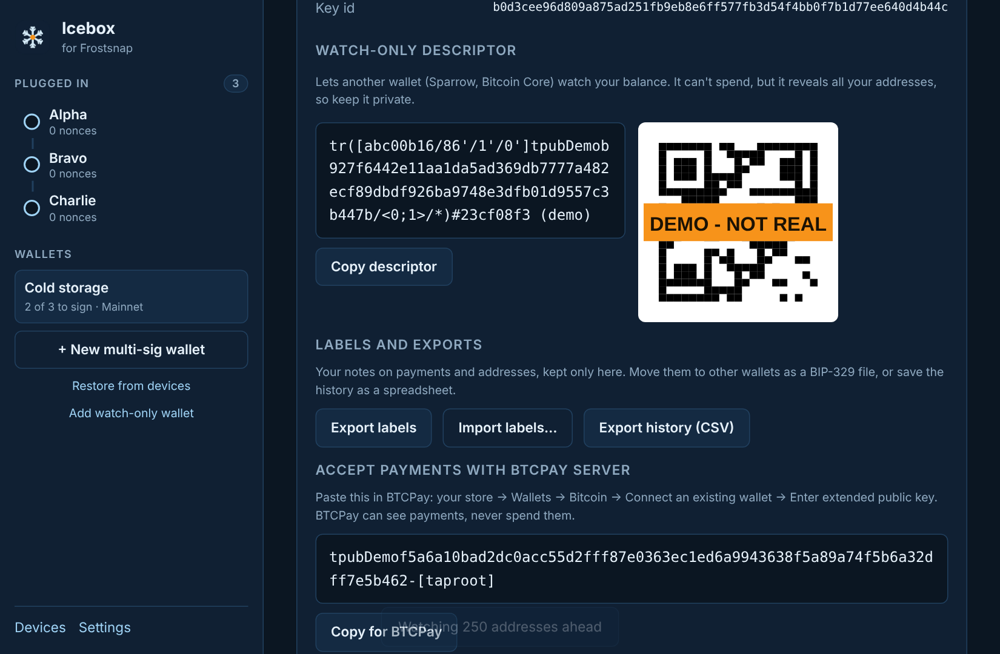

# 13. Labels, coins and exports

[← Troubleshooting](12-troubleshooting.md) · [Contents](README.md) · Next: [Android (beta) →](14-android.md)

*New in Icebox 0.5.*

## Labels

A **label** is your own short note on a payment, an address or a coin: "Order #1047", "Supplier:
packaging", "Opening float". Labels make the history readable months later, and they go into the
exports below. They're kept only by this copy of Icebox and are never sent anywhere: not to your
Electrum server, not with a payment.

- **Payments:** on the **History** tab, click **+ label** under a transaction (or the label itself
  to change it), type, and press **Enter** or **Save**. **Escape** cancels. Clear the text and save
  to remove a label.
- **Addresses:** on the **Receive** tab, click **+ label** under the address heading. The label
  shows in **All receive addresses** too.
- **Coins:** on the **Coins** tab (below).
- **When you send:** the Send page has a **Note** box. It becomes the payment's label as soon as
  signing starts, so it's there whether you broadcast straight away or later from *Payments in
  progress*. Cancelling the payment removes it.

Labels are up to 255 characters. Removing a wallet from Icebox removes its labels too, so export
them first if you'll want them back.

## Coins

Each payment into the wallet, and each bit of change from a payment out, is a separate **coin**.
The **Coins** tab lists them, newest first, with the address each was paid to, its amount and
confirmations. A coin's own label shows if it has one; if not, Icebox shows the label of the
payment or address it came from ("from: Order #1047").

### Combine coins

A payment spends whole coins, and each coin adds to its fee. A shop that takes many small payments
ends up with many small coins, and paying a supplier from them later costs more. **Combining**
moves chosen coins back into the same wallet as one coin, ideally while fees are low.

1. Tick two or more coins (the box in the header ticks them all). With only one coin there's
   nothing to combine, so the tick boxes don't show.
2. Enter a fee rate. Low is fine; combining isn't urgent.
3. Click **Review combining**. The Send tab shows the new coin's amount and the fee.
4. Choose which devices sign and **Start signing**, then approve on each device and **Broadcast**,
   just like a payment. There's no outside recipient: everything except the fee comes back to
   this wallet.

> **Combining links coins together.** Anyone watching the blockchain can see the combined coins
> belong to the same person. Don't combine coins you'd rather keep apart, for example ones from
> different customers, or your shop's and your own.

### Paying from chosen coins

Choosing which coins pay *someone else* needs a small change in the Frostsnap library Icebox is
built on. That change has been proposed to Frostsnap; Icebox will add it once it's in. For now,
Icebox picks the coins for a payment itself, as the official app does.

### "Don't spend" marks from other wallets

A label file from another wallet (such as Sparrow) can mark a coin **don't spend**. Icebox shows
the mark and keeps it when you export labels again, but can't yet keep a marked coin out of an
ordinary payment.

## Exports

On the **Details** tab, under **Labels and exports**:

- **Export labels** saves every label as a **BIP-329** file (`.jsonl`), the standard other
  wallets read: Sparrow, BTCPay Server, another Icebox and others can import it.
- **Import labels…** reads a BIP-329 file. A label in the file replaces the one saved for the same
  payment, address or coin; anything else is left alone. Icebox says how many were imported,
  already the same, or skipped (lines it couldn't read).
- **Export history (CSV)** saves the payment history as a spreadsheet: date and time (UTC),
  transaction id, amount and fee in BTC, status and label. With [prices](10-settings.md#prices)
  switched on, it adds each payment's value in your currency on the day it happened. For that
  Icebox downloads the whole price history in one go, so the price server never learns which days
  you had payments.

Files go into your **Downloads** folder (on a phone, or if Downloads can't be written, into
Icebox's own data folder), named after the wallet and the date. They're never overwritten: a
second export the same day gets " (2)". **Show in folder** opens it.

> Exports reveal your payments and amounts. Keep them as private as the wallet itself.

[← Troubleshooting](12-troubleshooting.md) · [Contents](README.md) · Next: [Android (beta) →](14-android.md)
