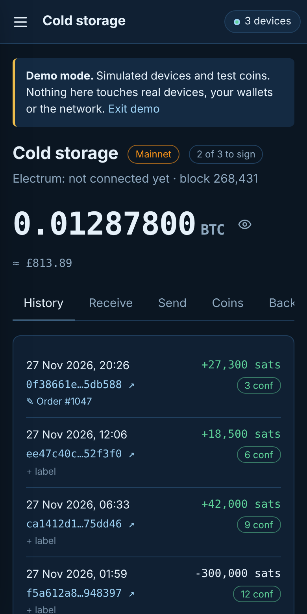

# 14. Icebox on Android (beta)

[← Labels, coins and exports](13-labels-coins-and-exports.md) · [Contents](README.md) · Next: [FAQ →](faq.md)

*New in Icebox 0.5, as a beta.*

Icebox runs on Android phones too, talking to Frostsnap devices through the phone's USB-C port.
It's the same app as on the desktop (the same wallets, labels and settings), laid out for a
phone: the menu button at the top left opens the sidebar.

> **Beta** means it works for us, but has had less testing than the desktop app. Try it on Signet
> first, and keep mainnet amounts small until you trust it on your phone.

## What you need

- An Android phone running Android 7 or newer with a 64-bit (arm64) processor. Nearly every phone
  from the last several years qualifies.
- A way to plug a Frostsnap device into the phone: the device's USB-C plug fits most phones
  directly; otherwise a USB-C OTG adapter or cable.

## Install

Icebox isn't in the Google Play Store. Download it from the project's GitHub releases page:

1. On the phone, open the [latest release](https://github.com/amisatoshi/icebox/releases/latest)
   and download **`Icebox_X.Y.Z_android-beta.apk`**.
2. Open the downloaded file. Android asks whether to allow your browser (or Files app) to install
   apps; allow it for this install, then turn it off again afterwards if you like.
3. Tap **Install**. Play Protect may warn that it doesn't recognise the app; choose to install
   anyway (Icebox is open source and built on GitHub from the published code).

### Check the download (recommended)

Every release lists the APK's **SHA-256** in `SHA256SUMS` and, in the release notes, the
fingerprint of the certificate it's signed with. Updates are only accepted by Android if they're
signed with the same certificate, so checking it once, when you first install, matters most.

On a computer with the Android SDK, `apksigner verify --print-certs Icebox_X.Y.Z_android-beta.apk`
shows the certificate's SHA-256 fingerprint. It must match the one in the release notes and the
README.

## Plugging in a device

Plug the Frostsnap device into the phone. Android asks **"Allow Icebox to access Frostsnap?"**: tap
**OK** (tick *Always open Icebox when this is connected* if you want). Within a few seconds the
device appears on the Devices page. Daisy-chained devices work the same way as on a computer.

If nothing happens:

- Unplug and plug in again, then wait a few seconds.
- Try another cable or adapter: some cables only charge.
- **GrapheneOS:** *Settings → Security → USB-C port* blocks new USB devices while the phone is
  locked. Keep the phone unlocked while you plug in, or change that setting.

## Updating

Download and install the new APK over the old one, the same way. Your wallets and settings stay.
If Android says the app "conflicts with an existing package", the new APK isn't signed with the
same key: don't force it. Check where you downloaded it from.

## Good to know

- **Where data is kept:** in Icebox's private app storage on the phone. Like on a computer, it holds
  no private keys, but it does reveal your addresses and history. Use a screen lock.
- **Uninstalling deletes that data** (wallets can be restored from the devices; labels can't, so
  export them first from Details → Labels and exports).
- **Exports** go to the phone's Downloads folder, or Icebox's own folder if Downloads can't be
  written.
- **Not on Android yet:** scanning QR codes with the camera, and the menu bar (its items are in the
  sidebar's **More** section).

[← Labels, coins and exports](13-labels-coins-and-exports.md) · [Contents](README.md) · Next: [FAQ →](faq.md)
